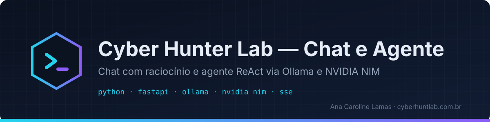

<p align="center"></p>

# Cyber Hunter Lab — chat de IA e agente ReAct para pesquisa de segurança

Aplicação com back-end **FastAPI (Python)** e front-end de página única que oferece um **chat com modelos de linguagem** com streaming e exibição do raciocínio (`<think>`), e um **agente autônomo ReAct** (pensamento → ação → observação → resposta) voltado a tarefas de investigação de segurança. Os modelos rodam **localmente via Ollama** (por exemplo, DeepSeek-R1) ou **na nuvem via NVIDIA NIM**.

## Recursos

- **Chat em tempo real** por Server-Sent Events (`POST /api/chat/stream`), com Markdown, destaque de código e botão de copiar.
- **Painel de raciocínio** retrátil para modelos que expõem o processo de pensamento.
- **Agente ReAct** (`POST /api/agent/stream`) com ferramentas para:
  - executar comandos no terminal do servidor;
  - fazer requisições HTTP.
- **Seletor de modelos** (`GET /api/models`) entre Ollama local e NVIDIA NIM; informações do servidor em `GET /api/info`.
- **Entrada por voz** no navegador e interface responsiva.

## Instalação

Requisitos: **Python 3.10+** e, para modelos locais, o **Ollama**.

```bash
git clone https://github.com/ticarollamas-arch/Deepseek-cyberhuntlab.git
cd Deepseek-cyberhuntlab
python3 -m venv venv && source venv/bin/activate
pip install fastapi uvicorn httpx pydantic
ollama pull deepseek-r1:8b      # ou outro modelo local
```

| Variável | Uso |
|---|---|
| `OLLAMA_URL` / `OLLAMA_MODEL` | Ollama local (padrão `http://localhost:11434`) |
| `OLLAMA_NUM_CTX`, `OLLAMA_NUM_PREDICT`, `OLLAMA_TEMPERATURE` | Contexto, tamanho da resposta e temperatura |
| `NVIDIA_API_KEY` / `NVIDIA_URL` | Modelos em nuvem da NVIDIA NIM (opcional) |

## Como usar

```bash
python3 server.py
# ou: uvicorn server:app --host 127.0.0.1 --port 3000
```

Abra `http://localhost:3000`, escolha o modelo e converse, ou ative o modo agente para tarefas em várias etapas.

## Segurança

> **Atenção:** a ferramenta de terminal do agente executa comandos de shell no servidor, protegida apenas por uma lista de bloqueio com poucos padrões (como `rm -rf`, `mkfs`, `shutdown`).
>
> - Rode **somente localmente** ou num container ou VM isolado, sem dados sensíveis.
> - **Nunca exponha** o servidor à internet sem autenticação.
> - Use apenas em alvos próprios ou com autorização por escrito.

## Tecnologias

Python · FastAPI · Uvicorn · httpx · Pydantic · Server-Sent Events · Ollama · NVIDIA NIM · HTML/Tailwind CSS · Marked.js · Web Speech API

## Licença

Distribuído sob a licença MIT. Veja [LICENSE](LICENSE).
